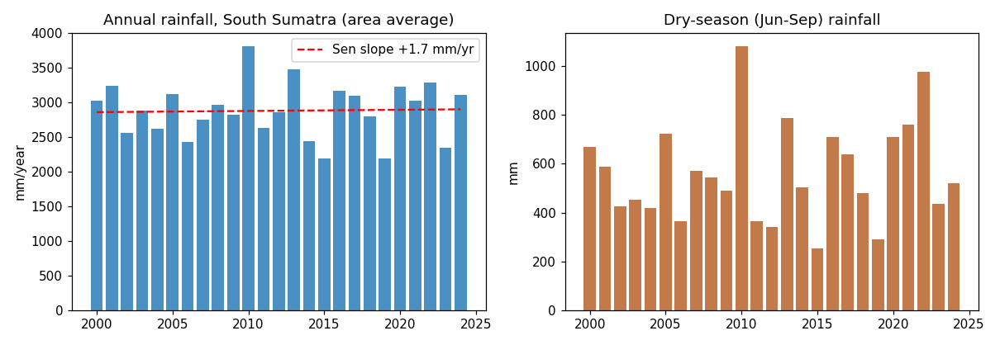
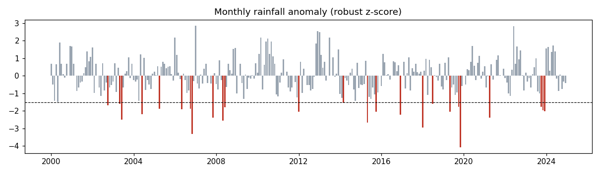
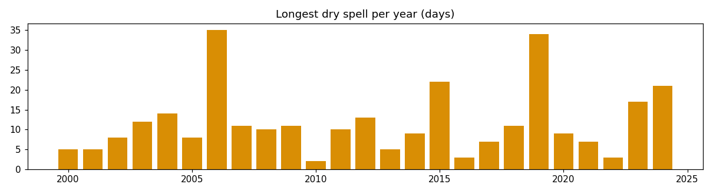
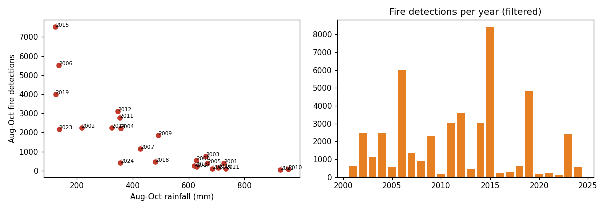
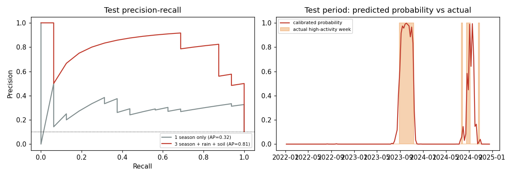
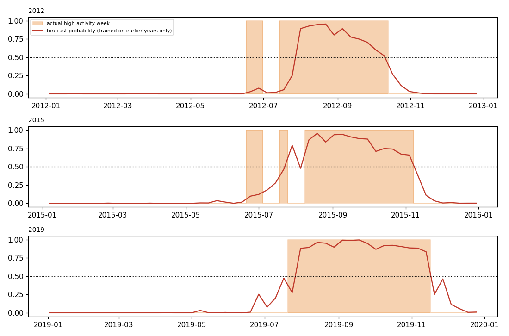
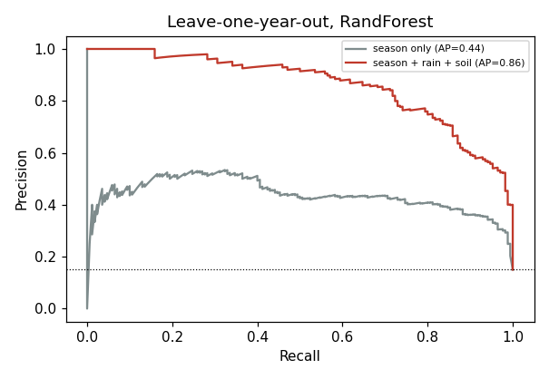
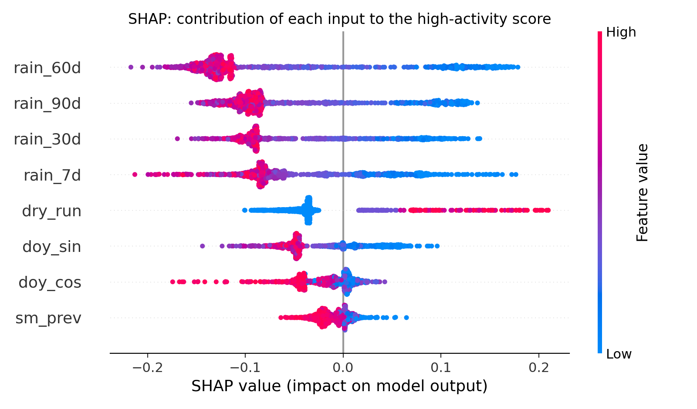
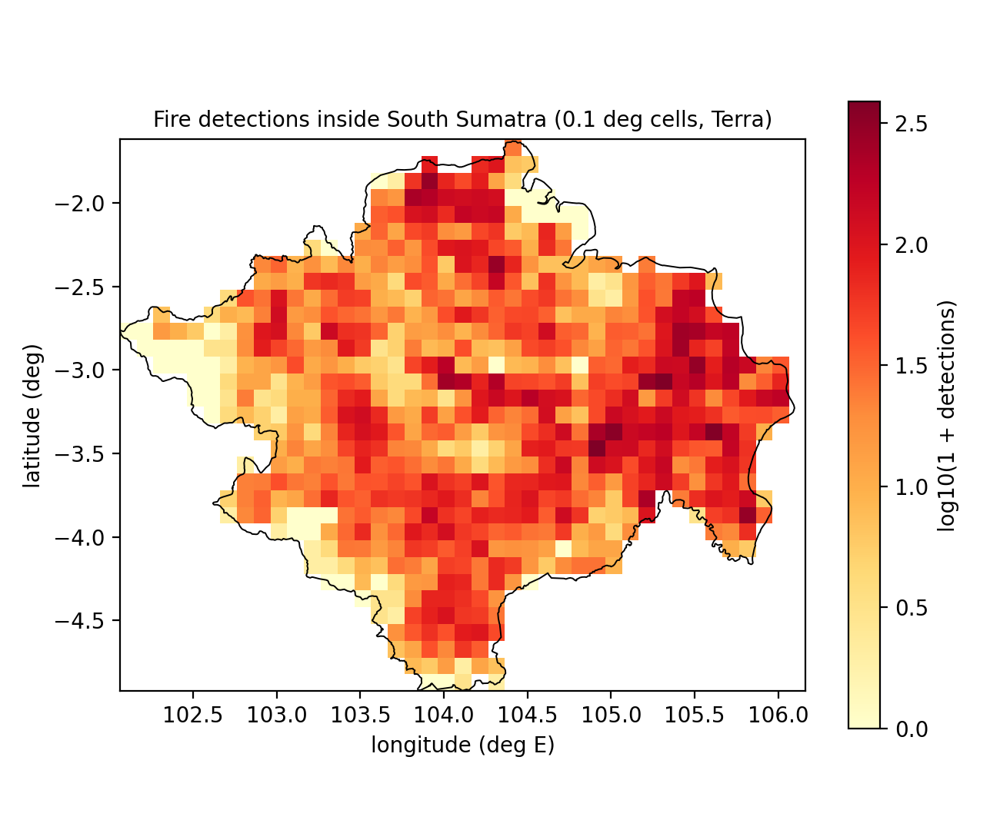

# 🌍 TerraWatch AI
### An Earth System Trend Detective for South Sumatra, Indonesia

  <strong>Understanding Environmental Changes Through Data, Statistics, and Artificial Intelligence</strong>

---

## 📌 Overview

TerraWatch AI is an environmental data science project designed to investigate long-term environmental changes, climate variability, and potential relationships between rainfall, soil moisture, and fire activity, initially focusing on **South Sumatra, Indonesia** as its prototype study area.

By integrating satellite-derived Earth observation datasets, statistical analysis, and machine learning, the project explores four fundamental questions:

- **What is changing?**
- **Where is it changing?**
- **By how much?**
- **Are the observed changes statistically significant?**

Rather than focusing exclusively on long-term trends, TerraWatch AI also investigates interannual variability, extreme dry spells, and environmental patterns relevant to regional environmental monitoring and early-warning research.

South Sumatra serves as an initial development and testing area, allowing the analytical framework to be developed and evaluated within a defined geographical context. The platform is designed with scalability in mind, with the potential to expand to other regions of Sumatra and eventually across Indonesia.

## 🔬 Project Overview

| Attribute | Description |
|---|---|
| Project | TerraWatch AI |
| Domain | Environmental Data Science |
| Study Area | South Sumatra, Indonesia (Initial Prototype) |
| Temporal Coverage | 2000–2024 (rainfall analysis) |
| Data Sources | NASA GPM IMERG, MERRA-2, NASA FIRMS |
| Statistical Methods | Mann-Kendall, Sen's Slope |
| Machine Learning | Predictive Modeling, Model Evaluation |
| Explainability | SHAP |
| Status | Research Prototype |

---

## 🛰️ Data Sources

TerraWatch AI integrates three major Earth observation datasets.

### 1. NASA GPM IMERG — Precipitation

Satellite-based precipitation estimates used to investigate:

- Long-term rainfall trends.
- Rainfall anomalies.
- Interannual variability.
- Extreme dry periods.

Source: [NASA Global Precipitation Measurement](https://gpm.nasa.gov/data)

### 2. NASA MERRA-2 — Soil Moisture

A global atmospheric reanalysis dataset used to investigate soil moisture conditions and environmental variability.

Source: [NASA GES DISC](https://disc.gsfc.nasa.gov/)

### 3. NASA FIRMS — Active Fire Detections

MODIS active fire observations used to examine fire activity and its potential relationships with rainfall and dry conditions.

Source: [NASA FIRMS](https://firms.modaps.eosdis.nasa.gov/)

For detailed dataset information and acquisition notes, see [`data/README.md`](data/README.md).

---

## ⚙️ Methodology

### 1. Statistical Trend Analysis

- Mann-Kendall trend test.
- Sen's slope estimator.
- Rainfall anomaly analysis.
- Interannual variability assessment.
- Extreme dry-spell analysis.

### 2. Environmental Relationship Analysis

- Rainfall and soil moisture variability.
- Rainfall and fire activity relationships.
- Temporal and spatial pattern exploration.

### 3. Machine Learning

- Predictive modeling.
- Walk-forward validation.
- Leave-One-Year-Out (LOYO) evaluation.
- Model performance and generalization assessment.

### 4. Explainable AI

- SHAP feature importance.
- Model interpretation.
- Identification of influential environmental variables.

---

## 📊 Key Research Findings

The rainfall analysis indicates that long-term precipitation trends are not statistically significant under the applied Mann-Kendall test, despite substantial year-to-year variability.

The analysis also identifies extreme dry periods, including a documented dry spell reaching **35 consecutive days**.

These findings highlight an important distinction:

> The absence of a statistically significant long-term trend does not imply the absence of environmental variability or extreme conditions.

Further analysis investigates soil moisture conditions, fire activity, and the potential contribution of environmental variables to observed patterns.

*Statistical associations and predictive relationships should not automatically be interpreted as causal relationships.*

---

## 📈 Visualization Gallery

The following figures summarize nine major analytical outputs of TerraWatch AI.

### 1. Rainfall Trend Analysis

### 2. Rainfall Anomaly Analysis

### 3. Extreme Dry-Spell Analysis

### 4. Rainfall and Fire Relationship

### 5. Machine Learning Results

### 6. Walk-forward Validation

### 7. Leave-One-Year-Out Evaluation

### 8. SHAP Feature Importance

### 9. Provincial Fire Density

---

## 📁 Repository Structure

    TerraWatch-AI/
    │
    ├── notebooks/
    │   └── terrawatch-ai.ipynb
    │
    ├── data/
    │   └── README.md
    │
    ├── results/
    │   └── figures/
    │       ├── fig_trend.png
    │       ├── fig_anomaly.png
    │       ├── fig_dryspell.png
    │       ├── fig_fire_link.png
    │       ├── fig_ml.png
    │       ├── fig_walkforward.png
    │       ├── fig_loyo.png
    │       ├── fig_shap_summary.png
    │       └── fig_fire_density_province.png
    │
    ├── .gitignore
    ├── requirements.txt
    ├── README.md
    └── LICENSE

---

## 🚀 Reproducibility

The analytical workflow is documented in the Jupyter notebooks available in the [`notebooks/`](notebooks/) directory.

### 1. Clone the Repository

    git clone https://github.com/HndrxCodes/TerraWatch-AI.git
    cd TerraWatch-AI

### 2. Install Dependencies

    pip install -r requirements.txt

### 3. Obtain the Required Datasets

Follow the instructions in [`data/README.md`](data/README.md) and obtain the original datasets from their respective official providers.

### 4. Run the Notebooks

Open the notebooks using Jupyter Notebook, JupyterLab, or Google Colab.

If using Kaggle, attach the required datasets and adjust input paths to the Kaggle environment.

*Reproduction requires compatible dataset versions, file paths, preprocessing steps, and execution environments.*

---

## ⚠️ Limitations

- Satellite-derived observations have spatial and temporal resolution limitations.
- Reanalysis products are estimates and may not perfectly represent local ground conditions.
- Active fire detections do not directly represent total burned area.
- Statistical relationships do not establish causality.
- Machine learning performance must be interpreted in the context of the validation strategy and available observations.

---

## 🎯 Project Vision

TerraWatch AI aims to demonstrate how open Earth observation data, statistical reasoning, and explainable machine learning can be combined to better understand regional environmental dynamics.

The initial prototype focuses on South Sumatra, but the long-term vision is to develop a scalable environmental monitoring and early-warning framework that can eventually extend across Sumatra and other regions of Indonesia.

---

## 👨‍💻 Author

**HndrxCodes**

GitHub: [@HndrxCodes](https://github.com/HndrxCodes)

---

  <i>TerraWatch AI — Understanding environmental changes through data, statistics, and artificial intelligence.</i>

